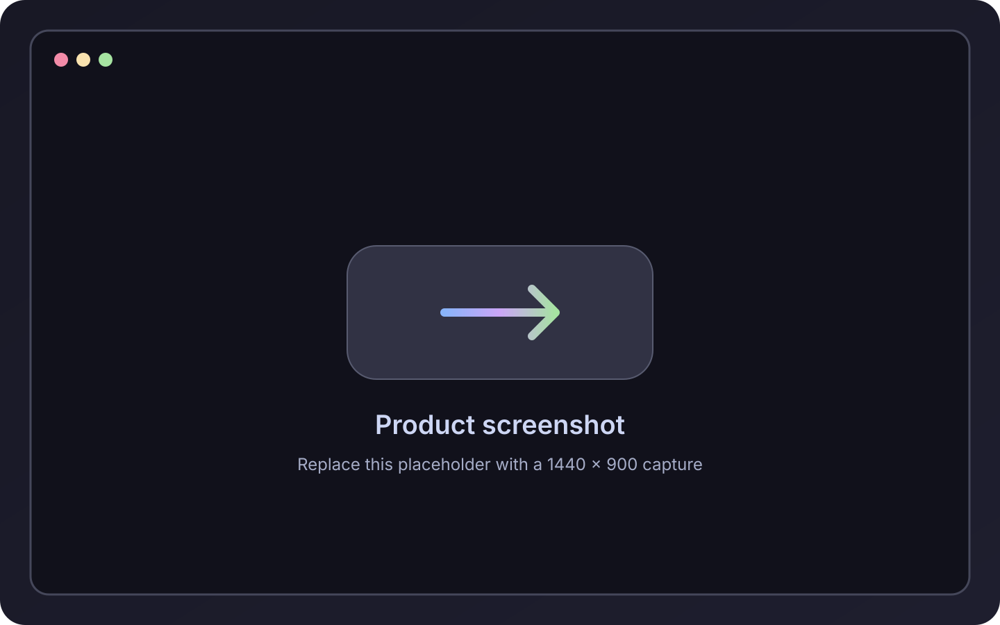

# LiquidCat
<div align="center">

<!-- Replace this placeholder with your final banner: assets/readme/liquidcat-banner.png -->


<br>

# LiquidCat

### Download · Convert · Re-encode

**A polished desktop workspace for downloading and transforming multimedia—powered by yt-dlp and FFmpeg, without the usual setup friction.**

<br>

[](#installation)
[](#overview)
[](https://github.com/yt-dlp/yt-dlp)
[](https://ffmpeg.org/)
[](https://catppuccin.com/)

<br>

[Features](#features) · [Screenshots](#screenshots) · [Installation](#installation) · [Roadmap](#roadmap) · [Authors](#authors)

</div>

---

## Overview

LiquidCat brings media downloading, conversion and re-encoding into one focused desktop application. Paste a compatible link or select a local file, choose the result you want, and let LiquidCat handle the processing pipeline.

It bundles the tools it needs, so users do not have to install Python, FFmpeg or yt-dlp separately.

> [!NOTE]
> LiquidCat is designed for media you own or are authorized to download and process. You are responsible for respecting applicable copyright rules and platform terms.

## Features

<table>
<tr>
<td width="50%" valign="top">

### Download

- Download video or audio from links supported by yt-dlp
- Choose format, resolution and quality
- Include subtitles, thumbnails and metadata
- Select the destination folder before processing

</td>
<td width="50%" valign="top">

### Convert

- Convert media to MP3, M4A, FLAC and other formats
- Re-encode local video and audio files
- Use FFmpeg with hardware acceleration when available
- Trim a specific segment without leaving the app

</td>
</tr>
<tr>
<td width="50%" valign="top">

### Organize

- Manage multiple jobs through a processing queue
- Review completed and previous jobs in history
- Track each task from preparation to completion

</td>
<td width="50%" valign="top">

### Finish

- Open the resulting file immediately
- Jump directly to its destination folder
- Keep the complete workflow inside one interface

</td>
</tr>
</table>

## Screenshots

<div align="center">

<!-- Replace these placeholders with real screenshots. Recommended size: 1440 × 900 px. -->

| Downloader | Converter |
|:---:|:---:|
|  |  |
| Paste a link, inspect the available options and choose the output. | Convert or re-encode local files with precise control. |

| Queue & history | Output settings |
|:---:|:---:|
|  |  |
| Follow active jobs and revisit completed work. | Configure quality, metadata, subtitles and destination. |

</div>

## Tech stack

| Component | Role |
|---|---|
| [yt-dlp](https://github.com/yt-dlp/yt-dlp) | Link extraction and media downloads |
| [FFmpeg](https://ffmpeg.org/) | Conversion, re-encoding, trimming and media processing |
| Hardware acceleration | Faster compatible encoding workloads when supported |
| Desktop application | A single graphical workflow for downloads and local files |

## Installation

### Windows

1. Open the repository's **Releases** page.
2. Download the latest LiquidCat package for Windows.
3. Extract it if the download is provided as an archive.
4. Run `LiquidCat.exe`.

Python, FFmpeg and yt-dlp do not need to be installed separately.

> [!IMPORTANT]
> Source-build instructions depend on the project's development toolchain and should be added once that toolchain is published in the repository.

## How it works

```text
Link or local file
        ↓
Choose format, quality and optional extras
        ↓
LiquidCat prepares the yt-dlp / FFmpeg job
        ↓
Track progress in the queue
        ↓
Open the finished file or its destination folder
```

## Roadmap

- [x] Link-based video and audio downloads
- [x] Format, resolution and quality selection
- [x] Local file conversion and re-encoding
- [x] Trimming, subtitles, thumbnails and metadata
- [x] Processing queue and job history
- [x] Self-contained runtime for end users
- [ ] Reusable download and conversion presets
- [ ] Batch import for links and local files
- [ ] Expanded accessibility and keyboard navigation
- [ ] Additional application languages

Roadmap items may change as LiquidCat evolves.

## Contributing

Issues and focused pull requests are welcome. Before proposing a large change, open an issue so the scope and expected behavior can be discussed first.

## Authors

Built by **JuanFX** and **Adaki**.

## Acknowledgements

LiquidCat is made possible by the excellent work behind [yt-dlp](https://github.com/yt-dlp/yt-dlp), [FFmpeg](https://ffmpeg.org/) and the [Catppuccin](https://catppuccin.com/) color palette.

---

<div align="center">

<sub>Crafted with glass, color and a little bit of cat energy.</sub>

</div>
