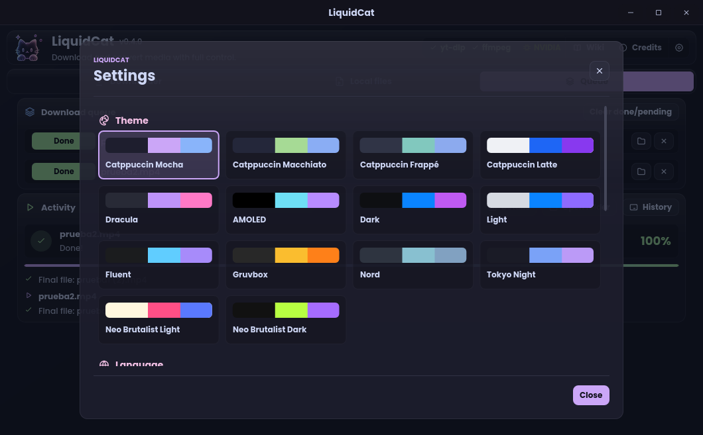
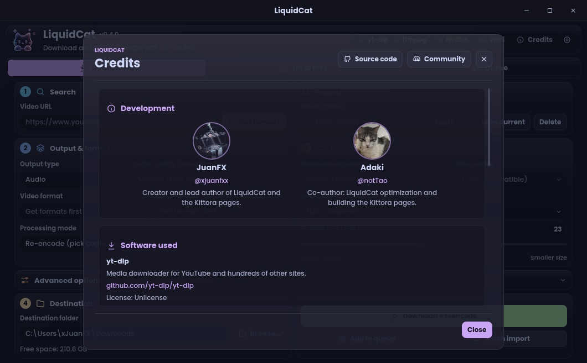

<div align="center">

<!-- Replace this placeholder with your final banner: assets/readme/liquidcat-banner.png -->


<br>

# LiquidCat

### Download · Convert · Re-encode

**A polished, native desktop workspace for downloading and transforming multimedia—powered by yt-dlp and FFmpeg, without the usual setup friction or WebView bloat.**

<br>

[](#installation)
[](#tech-stack)
[](#license)
[](#tech-stack)
[](https://github.com/yt-dlp/yt-dlp)
[](https://ffmpeg.org/)

<br>

[Features](#features) · [Screenshots](#screenshots) · [Installation](#installation) · [Roadmap](#roadmap) · [Authors](#authors)

</div>

---

## Overview

LiquidCat brings media downloading, conversion and re-encoding into one focused desktop application. Paste a compatible link or select a local file, choose the result you want, and let LiquidCat handle the processing pipeline.

This version is a **complete native rewrite** from the ground up. Tauri and WebView2 have been completely removed; the interface is now drawn using **Rust and Slint**, resulting in a snappy, single-executable experience.

> [!NOTE]
> LiquidCat is lighter than the previous WebView2-based build. Expect around 60 MB at idle in Task Manager on Windows; actual usage varies with the active renderer and theme.

> [!NOTE]
> LiquidCat is designed for media you own or are authorized to download and process. You are responsible for respecting applicable copyright rules and platform terms.

## Features

<table>
<tr>
<td width="50%" valign="top">

### Download

- Download video or audio from links supported by yt-dlp
- Batch import: paste many links at once or load them from a `.txt`
- Choose format, resolution and quality
- Include subtitles, thumbnails and metadata
- Select the destination folder before processing

</td>
<td width="50%" valign="top">

### Convert

- Convert media to MP3, M4A, FLAC and other formats
- Re-encode local video and audio files (pick or drag several at once)
- Use FFmpeg with hardware acceleration (NVENC/AMF/CPU)
- Trim a specific segment without leaving the app

</td>
</tr>
<tr>
<td width="50%" valign="top">

### Organize

- Manage multiple jobs through a processing queue
- Review completed and previous jobs in history
- Track each task from preparation to completion in a floating Activity card (with cancel)
- Start with eight built-in presets, including **H.264 compatible** (best H.264 + AAC with no re-encode, plays everywhere)
- Keep your existing presets and history (fully compatible with the old `config.json`)

</td>
<td width="50%" valign="top">

### Finish

- Open the resulting file immediately
- Get notified when a new LiquidCat version is out (Settings → About)
- Jump directly to its destination folder
- Keep the complete workflow inside one interface
- 14 built-in themes (including Catppuccin), each with its own cat icon
- Available in English, Spanish, Portuguese, French, German and Italian

</td>
</tr>
</table>

## Screenshots

<div align="center">

<!-- Screenshots captured at 1060 px wide (LiquidCat 0.4, Catppuccin Mocha). -->

| Downloader | Local files |
|:---:|:---:|
|  |  |
| Paste a link to see a preview, pick the format and download. | Convert several files at once and follow them in the floating Activity card. |

| Queue & activity | Settings |
|:---:|:---:|
|  |  |
| Follow active jobs and revisit completed work. | 14 themes, 6 languages, dependencies and update checks. |

| Credits |
|:---:|
|  |
| The people and open-source projects behind LiquidCat. |

</div>

## Tech stack

| Component | Role |
|---|---|
| [Rust](https://www.rust-lang.org/) | Core backend, performance, and logic |
| [Slint](https://slint.dev/) | Native UI toolkit (no WebView required) |
| [yt-dlp](https://github.com/yt-dlp/yt-dlp) | Link extraction and media downloads |
| [FFmpeg](https://ffmpeg.org/) | Conversion, re-encoding, trimming and media processing |

## Installation

### Windows

1. Open the repository's **[Releases](https://github.com/Kittora/LiquidCat/releases)** page.
2. Download the latest `LiquidCat-0.4.5-windows-x86_64.exe`.
3. Run `LiquidCat.exe`. 

*Note: **Python is not required.** LiquidCat automatically downloads and manages its own yt-dlp (kept up to date) and FFmpeg/ffprobe in the background.*

### Linux and macOS (experimental)

These builds are new and have had little testing. Feedback is very welcome.

- **Linux:** download `LiquidCat-0.4.5-linux-x86_64.tar.gz` (PC) or `LiquidCat-0.4.5-linux-aarch64.tar.gz` (ARM 64-bit, e.g. Raspberry Pi 4/5), extract it and run `./LiquidCat`. Install FFmpeg with your package manager (for example `sudo apt install ffmpeg`).
- **macOS:** download `LiquidCat-0.4.5-macos-arm64.zip` (Apple Silicon) or `LiquidCat-0.4.5-macos-x86_64.zip` (Intel), unzip it and move `LiquidCat.app` to *Applications*. The app is not notarized, so the first time right-click it and choose **Open**. Install FFmpeg with `brew install ffmpeg`.

LiquidCat downloads its own yt-dlp on every platform.

> [!IMPORTANT]
> **Building from source:** You will need Rust 1.88+ installed. Simply clone the repository and run `cargo build --release`. 
> Alternatively, you can just push the code to GitHub and use the included **Build Windows** and **Build Linux & macOS** GitHub Actions to get the builds automatically.

## How it works

```text
Link or local file
        ↓
Choose format, quality and optional extras
        ↓
LiquidCat prepares the yt-dlp / FFmpeg job
        ↓
Track progress in the queue
        ↓
Open the finished file or its destination folder
```

## Roadmap

- [x] Link-based video and audio downloads
- [x] Format, resolution and quality selection
- [x] Local file conversion and re-encoding
- [x] Trimming, subtitles, thumbnails and metadata
- [x] Processing queue and job history
- [x] Self-contained runtime for end users
- [x] Reusable download and conversion presets
- [x] Batch import for links and local files
- [x] Additional application languages (PT, FR, DE, IT)
- [ ] Expanded accessibility and keyboard navigation

Roadmap items may change as LiquidCat evolves.

## Contributing

Issues and focused pull requests are welcome. Before proposing a large change, open an issue so the scope and expected behavior can be discussed first.

## Authors

Built by **JuanFX** ([@xjuanfxx](https://github.com/xjuanfxx)) and **Adaki** ([@notTao](https://github.com/notTao)).

## Acknowledgements

LiquidCat is made possible by the excellent work behind [yt-dlp](https://github.com/yt-dlp/yt-dlp), [FFmpeg](https://ffmpeg.org/), [Slint](https://slint.dev/), [Skia](https://skia.org/) and the [Catppuccin](https://catppuccin.com/) color palette.

## License

LiquidCat is free software, released under the **GNU General Public License v3.0** (GPL-3.0-only). See [`LICENSE`](LICENSE) for the full text. You can use, study, share and modify it; if you distribute a modified version, it must stay under the same license and include its source code.

Third-party components keep their own licenses:

- **[Slint](https://slint.dev/)** (user interface) is used under the GPL-3.0.
- **[Skia](https://skia.org/)** (graphics engine used by Slint) is under the BSD 3-Clause license.
- **[Poppins](https://github.com/itfoundry/Poppins)** fonts are bundled under the SIL Open Font License 1.1 ([`assets/fonts/OFL.txt`](assets/fonts/OFL.txt)).
- **yt-dlp** (Unlicense) and **FFmpeg** (GPL) are not bundled: LiquidCat downloads them from their official sources on first run.
- The Rust libraries LiquidCat is built on use permissive licenses (MIT, Apache-2.0, BSD, ISC, Zlib and similar).

---

<div align="center">

<sub>Crafted with glass, color and a little bit of cat energy.</sub>

</div>
