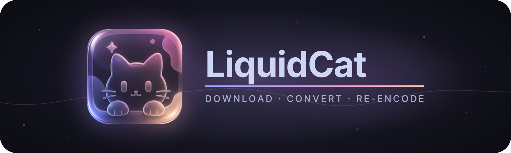
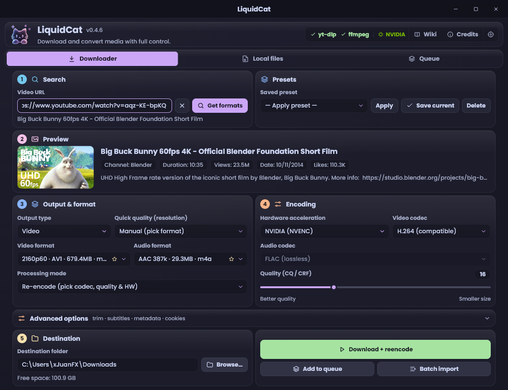
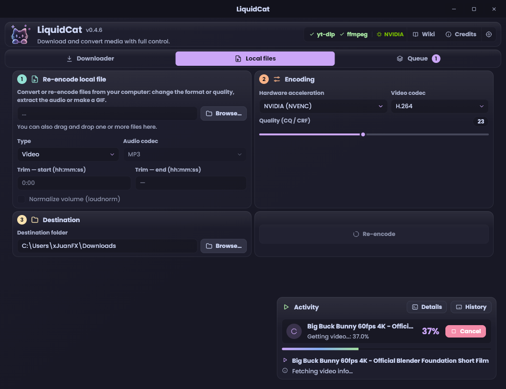
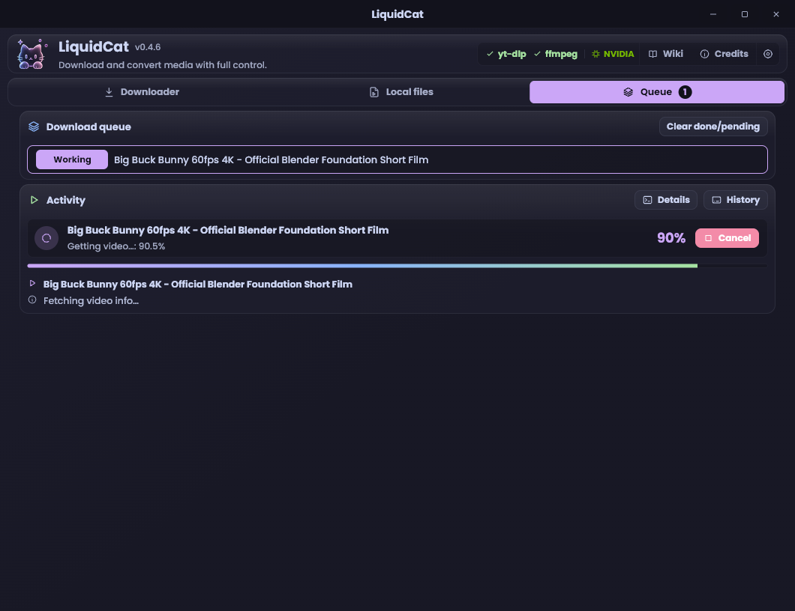
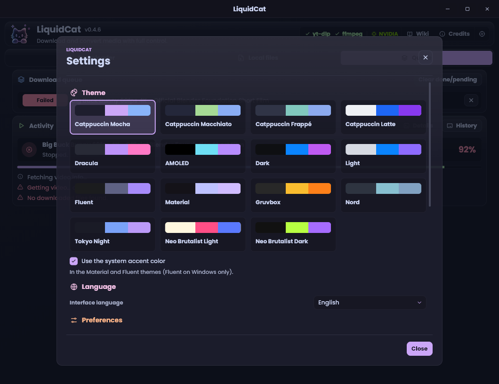
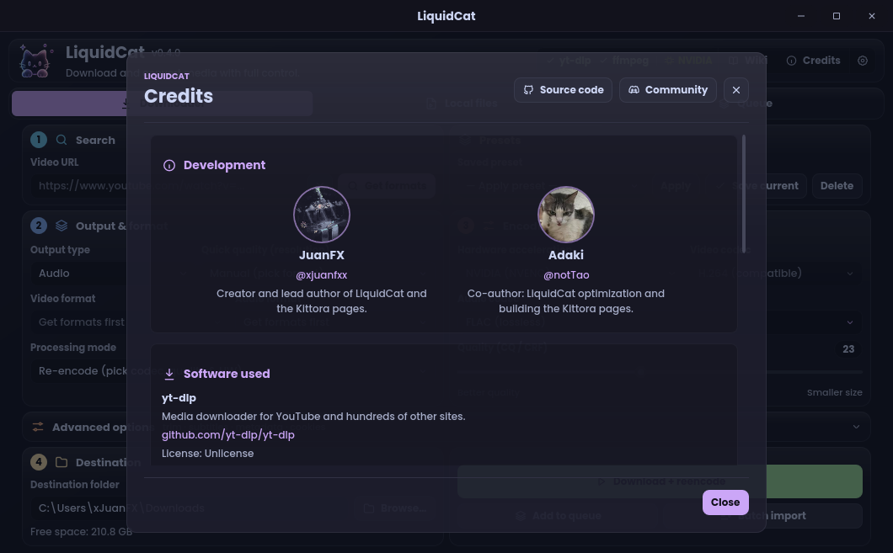

<div align="center">



<br>

# LiquidCat

### Download · Convert · Re-encode

**A polished, native desktop app for downloading and transforming video and audio, powered by yt-dlp and FFmpeg, without the usual setup friction or WebView bloat.**

<br>

[](https://github.com/Kittora/LiquidCat/releases/latest)
[](https://github.com/Kittora/LiquidCat/releases)
[](#installation)
[](#license)
[](#tech-stack)

<br>

**[Download](https://github.com/Kittora/LiquidCat/releases/latest)** · [Website](https://www.kittora.dev/liquidcat/) · [Features](#features) · [Screenshots](#screenshots) · [Installation](#installation) · [Building](#building-from-source) · [Roadmap](#roadmap)

</div>

---

## Overview

LiquidCat brings media downloading, conversion and re-encoding into one focused desktop application. Paste a link or pick a local file, choose the result you want, and LiquidCat handles the whole yt-dlp and FFmpeg pipeline for you.

It is written in **Rust** with a **Slint** interface drawn on the GPU by Skia: a single, portable executable with no WebView, no Python and no installer. yt-dlp and FFmpeg are downloaded and kept up to date automatically.

> [!NOTE]
> LiquidCat uses around 60 MB of memory at idle on Windows; actual usage varies with the renderer and the theme.

> [!NOTE]
> LiquidCat is meant for media you own or are allowed to download and process. You are responsible for respecting copyright and each platform's terms.

## Features

<table>
<tr>
<td width="50%" valign="top">

### Download

- Download video or audio from any site supported by yt-dlp
- Batch import: paste many links at once or load them from a `.txt`
- Choose format, resolution and quality, with the best option highlighted
- Include subtitles, thumbnails and metadata
- Use browser cookies for content that needs a sign-in

</td>
<td width="50%" valign="top">

### Convert

- Convert to MP3, M4A, FLAC, WAV, AAC, Opus or Ogg, or make a GIF
- Re-encode local video and audio files (pick or drag several at once)
- Hardware encoding with NVENC, AMF, Intel Quick Sync, VAAPI or VideoToolbox, detected automatically, with a CPU fallback
- Trim an exact segment, re-encoded on the GPU when available

</td>
</tr>
<tr>
<td width="50%" valign="top">

### Organize

- Manage multiple jobs through a processing queue
- Review completed jobs in the history
- Follow each task in a floating Activity card (with cancel) and get a system notification when it's done
- Start from eight built-in presets, including **H.264 compatible** (plays everywhere) or save your own

</td>
<td width="50%" valign="top">

### Make it yours

- 15 themes, each with its own cat icon: Catppuccin, **Material 3**, Fluent, Tokyo Night, Nord, Gruvbox, Neo Brutalist and more
- Material and Fluent follow your system accent color, live
- Available in English, Spanish, Portuguese, French, German and Italian (follows your system language)
- Checks for new versions of LiquidCat, yt-dlp and FFmpeg on launch

</td>
</tr>
</table>

## Screenshots

<div align="center">

<!-- Screenshots captured at 1060 px wide (LiquidCat 0.4, Catppuccin Mocha). -->

| Downloader | Local files |
|:---:|:---:|
|  |  |
| Paste a link to see a preview, pick the format and download. | Convert several files at once and follow them in the floating Activity card. |

| Queue & activity | Settings |
|:---:|:---:|
|  |  |
| Follow active jobs and revisit completed work. | 15 themes, 6 languages, dependencies and update checks. |

| Credits |
|:---:|
|  |
| The people and open-source projects behind LiquidCat. |

</div>

## Installation

Download the file for your system from the **[latest release](https://github.com/Kittora/LiquidCat/releases/latest)** (or from [kittora.dev](https://www.kittora.dev/liquidcat/#download)).

| System | File | Status |
|---|---|---|
| Windows 10 / 11 (x64) | `LiquidCat-<version>-windows-x86_64.exe` | Stable |
| Linux x86_64 | `LiquidCat-<version>-linux-x86_64.tar.gz` | Experimental |
| Linux ARM64 (e.g. Raspberry Pi 4/5) | `LiquidCat-<version>-linux-aarch64.tar.gz` | Experimental |
| macOS Apple Silicon | `LiquidCat-<version>-macos-arm64.zip` | Experimental |
| macOS Intel | `LiquidCat-<version>-macos-x86_64.zip` | Experimental |

### Windows

Run the `.exe`: it's portable, so there is nothing to install. The executable isn't code-signed yet, so Windows SmartScreen may warn you the first time; choose **More info → Run anyway**. LiquidCat downloads yt-dlp and FFmpeg on first launch and keeps them up to date.

### Linux and macOS (experimental)

These builds compile automatically on every release but have had little testing on real machines. Feedback is very welcome.

- **Linux:** extract the archive and run `./LiquidCat`. Install FFmpeg with your package manager (for example `sudo apt install ffmpeg`).
- **macOS:** unzip it and move `LiquidCat.app` to *Applications*. The app isn't notarized, so the first time right-click it and choose **Open**. Install FFmpeg with `brew install ffmpeg`.

LiquidCat downloads its own yt-dlp on every platform.

## Building from source

You need [Rust](https://www.rust-lang.org/tools/install) 1.88 or newer.

```bash
git clone https://github.com/Kittora/LiquidCat.git
cd LiquidCat
cargo build --release
```

The executable ends up in `target/release/`. On Linux, Slint and Skia also need the usual development packages (fontconfig, xkbcommon, Wayland/X11 and OpenGL headers); the [Linux & macOS workflow](.github/workflows/unix.yml) lists the exact ones. The **Build Windows** and **Build Linux & macOS** GitHub Actions produce the same release files.

## How it works

```text
Link or local file
        ↓
Choose format, quality and optional extras
        ↓
LiquidCat prepares the yt-dlp / FFmpeg job (GPU when available)
        ↓
Track progress in the queue and the Activity card
        ↓
Open the finished file or its destination folder
```

## Tech stack

| Component | Role |
|---|---|
| [Rust](https://www.rust-lang.org/) | Core backend, performance and logic |
| [Slint](https://slint.dev/) + [Skia](https://skia.org/) | Native UI toolkit, rendered on the GPU (no WebView) |
| [yt-dlp](https://github.com/yt-dlp/yt-dlp) | Link extraction and media downloads |
| [FFmpeg](https://ffmpeg.org/) | Conversion, re-encoding, trimming and media processing |
| [material-color-utilities](https://github.com/material-foundation/material-color-utilities) | Material 3 color schemes from your accent color |

## Roadmap

- [x] Link-based video and audio downloads
- [x] Format, resolution and quality selection
- [x] Local file conversion and re-encoding
- [x] Trimming, subtitles, thumbnails and metadata
- [x] Processing queue and job history
- [x] Self-contained runtime for end users
- [x] Reusable download and conversion presets
- [x] Batch import for links and local files
- [x] Additional application languages (PT, FR, DE, IT)
- [x] Linux and macOS builds (experimental)
- [x] Material 3 theme and system accent color
- [ ] Linux and macOS testing on real hardware
- [ ] Expanded accessibility and keyboard navigation

Roadmap items may change as LiquidCat evolves.

## Contributing

Issues and focused pull requests are welcome. Before proposing a large change, open an issue so the scope and expected behavior can be discussed first. See the [contributing guide](https://github.com/Kittora/.github/blob/main/CONTRIBUTING.md) for details.

Found a security issue? Please report it privately through **[Security → Report a vulnerability](https://github.com/Kittora/LiquidCat/security/advisories/new)** instead of a public issue.

## Authors

Built by **JuanFX** ([@xjuanfxx](https://github.com/xjuanfxx)) and **Adaki** ([@notTao](https://github.com/notTao)) at [Kittora](https://www.kittora.dev).

## Acknowledgements

LiquidCat is made possible by the excellent work behind [yt-dlp](https://github.com/yt-dlp/yt-dlp), [FFmpeg](https://ffmpeg.org/), [Slint](https://slint.dev/), [Skia](https://skia.org/), the [Catppuccin](https://catppuccin.com/) color palette and Google's [Material 3](https://m3.material.io/) design system.

## License

LiquidCat is free software, released under the **GNU General Public License v3.0** (GPL-3.0-only). See [`LICENSE`](LICENSE) for the full text. You can use, study, share and modify it; if you distribute a modified version, it must stay under the same license and include its source code.

Third-party components keep their own licenses:

- **[Slint](https://slint.dev/)** (user interface) is used under the GPL-3.0.
- **[Skia](https://skia.org/)** (graphics engine used by Slint) is under the BSD 3-Clause license.
- **[material-color-utilities](https://github.com/material-foundation/material-color-utilities)** (Material 3 colors) is under the Apache 2.0 license; LiquidCat uses its Rust port, the `material-colors` crate (MIT or Apache-2.0).
- **[Poppins](https://github.com/itfoundry/Poppins)** fonts are bundled under the SIL Open Font License 1.1 ([`assets/fonts/OFL.txt`](assets/fonts/OFL.txt)).
- **yt-dlp** (Unlicense) and **FFmpeg** (GPL) are not bundled: LiquidCat downloads them from their official sources on first run.
- The Rust libraries LiquidCat is built on use permissive licenses (MIT, Apache-2.0, BSD, ISC, Zlib and similar).

---

<div align="center">

<sub>Crafted with glass, color and a little bit of cat energy · <a href="https://www.kittora.dev">kittora.dev</a></sub>

</div>
